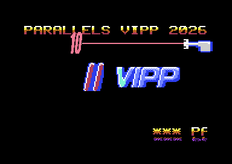
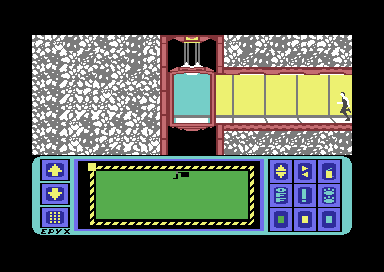
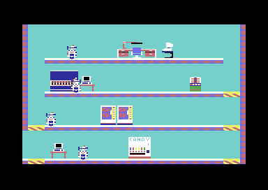
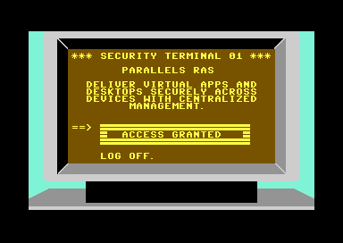
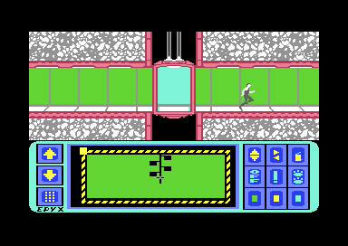
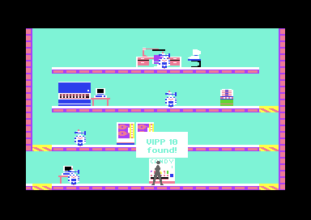
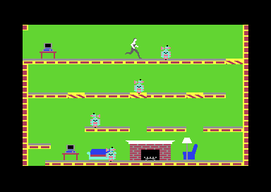

# VIPP Malta 2026: C64 demo

A small PAL demo for real Commodore 64 hardware (made for the Commodore 64 Ultimate):

- the VIPP logo as 21 multicolor sprites (3 rows × 7), bouncing on a sine/gravity path
- a hires **"10"** for the 10-year anniversary (sprite 0), bouncing off the screen edges on its own path
- **the attack:** when the "10" bumps into the logo, both freeze (the logo trembles) and the "10" recoils back the way it came, just clear of the logo. A laser gun slides in and shoots it three times. The beam is cut exactly at the "10". The "10" then shatters in a multicolor fire explosion: the screen flashes, the logo shakes and glows in the fire colours. Afterwards everything resumes.
- laser and explosion **sound effects** on SID voice 3, which is borrowed from the music's drums the way games did it
- a 2×2 multicolor scroller in an Ocean-style gold gradient, greeting all VIPP members, with a rippling **water reflection** below it (flipped, half height, orange fading into purple)
- music: *Commando* by Rob Hubbard (from HVSC)
- **VIPP Mission** (press **Space**, Space again returns): a self-playing *Impossible Mission* (Epyx, 1984) built from the original game's graphics, sounds and speech:
  - the speech intro ("Another visitor... stay a while... stay forever!")
  - the lift ride down the shaft with the original scrolling and hum, and the pocket computer's map
  - 5 original rooms with robots that patrol and fire
  - the security terminals, each showing a Parallels product (RAS, DaaS, Secure Workspace, Browser Isolation, Desktop)
  - searching furniture ("Nothing here." or the VIPP find)
  - two deaths per loop: a robot's zap and a fall with the scream
  - the speech plays at the original level on a 6581 SID; on an 8580 or FPGA SID it is boosted but quieter, so 6581 is the better setting for this mode

## Screenshots

The demo:

VIPP Mission:

| | |
|---|---|
|  |  |
| The lift ride: the shaft scrolls past the corridors | Room 23: the robot fires, the agent somersaults over it and searches the candy machine |
|  |  |
| A security terminal with a Parallels product | The map: the shaft, its corridors and the visited rooms |
|  |  |
| The VIPP find | Zapped: the original electrocution |

The GIFs are recorded in VICE with `tools/vicegif.py`.

## Run it

- **Emulator:** `.\run.ps1` builds the demo and opens it in VICE (PAL, normal speed, with sound).
- **Real C64 / C64 Ultimate:** copy `build\vipp.prg` (or `build\vipp.d64`) to a USB stick and start it from the Ultimate menu. Standard C64s load the `.d64` with `LOAD"*",8,1` and `RUN`.

The machine must be in **PAL** mode. On an NTSC machine the demo shows a message and stops.

## Build

`.\build.ps1` runs `tools\gen_assets.py`, assembles `src\main.asm` with 64tass and writes `build\vipp.prg` and `build\vipp.d64`.

The toolchain lives in `tools\`: 64tass 1.60, VICE 3.9 and Exomizer 3.1.2. You also need Python 3 with Pillow.

The program spans `$0801-$f77f`, so `build.ps1` packs `build\vipp_full.prg` with Exomizer (`sfx`) into one self-unpacking `build\vipp.prg`.

- **Exomizer:** no Windows binaries are offered any more. Download the source (`https://bitbucket.org/magli143/exomizer/get/3.1.2.zip`), unpack it into `tools\dl_exomizer\`, and run `tools\build-exomizer.bat` (needs Visual Studio 2022 C++ tools).
- **Impossible Mission data:** this repository is private (Epyx data, private event use only). `assets/im/` holds the extracted data the build uses; `assets/im_source/` what it was extracted from: the original `impossible_mission.d64` and VICE snapshots of the game (`lift_top.vsf`: the lift at the top of a shaft, `room29.vsf`: a room, `search.vsf`: searching, `terminal.vsf`: a security terminal), the recorded lift ride and a room dump. To extract again:
  - `python tools/im/extract.py assets/im/ram_005.bin --room assets/im_source/room_restore` (agent, robots, charsets, speech)
  - `python tools/im/record_lift.py assets/im_source/lift_top.vsf DIR`, then `python tools/im/extract_lift.py DIR` (the lift; the recording is in `assets/im_source/lift_ride`)
  - `python tools/im/extract_rooms.py assets/im_source/room29.vsf`, `extract_terminal.py assets/im_source/terminal.vsf`, `extract_search.py assets/im_source/search.vsf`
  The build stops with a clear message if anything is missing.

Test builds (64tass `-D`):

- `SYNC_TEST=1` repeats the timer sync.
- `MUSIC_DIRECT=1` uses the original music player.
- `SFX_OFF=1` keeps the SID stubs but turns the effects off.
- `DEBUG=1` shows IRQ time in the border.

## Changing things

| What | Where |
|---|---|
| Member names | `assets\members.txt` (one per line) |
| Scroll text around the names, title | `tools\gen_assets.py` (`gen_scrolltext`, `TITLE`) |
| Logo shading / colours | `tools\art.py` (`shade`, `logo_roles`), colours in `tools\gen_assets.py` |
| The "10", explosion, gun | `art.hires_ten`, `art.fire_frames` / `FIRE_COLOURS`, `tools\gun.py` |
| Font glyphs / gradient | `tools\font7.py`, `GOLD` in `tools\art.py` |
| Reflection style | `REFL_STYLE` in `tools\gen_assets.py`, styles in `art.REFL_STYLES` (`preview_art.py reflection` shows them) |
| Motion | `Y_MIN`/`Y_MAX`/`Y_LEN`, `X_MIN`/`X_MAX` in `tools\gen_assets.py`, `X_SPEED` in `src\main.asm` |
| Attack timing, shots, recoil | `ATK_*`, `SHOT_LEN`, `SHOTS`, `RECOIL_MIN`, `COOL_FRAMES` in `src\main.asm` |
| Sound effects | `sfx_hi` / `sfx_ctrl` tables and `sfx_*v` per effect in `src\main.asm` |

`tools\preview_art.py` and `tools\preview_ten.py` render option sheets without touching the demo.

Everything we learned (limits, timings, techniques, bugs, how to test) is in [`docs/C64_DEMO_NOTES.md`](docs/C64_DEMO_NOTES.md).

## How it works

- **Line 72-225 (FLD area):** one IRQ runs every raster line here.
  - It keeps YSCROLL one line behind the raster, so there are no badlines.
  - It works through a sorted list of events:
    - moving the sprites down for logo rows 2 and 3
    - swapping all 8 sprite pointers with one `$d018` write, which switches between three screens
    - lending sprite 7 to the gun and taking it back
    - drawing the laser beam
- **Laser beam:** CIA 1 timer A is synced to the raster at start-up with a double IRQ (period 63 cycles = one PAL line). One timer read gives the exact cycle. Then "sleds" of `cmp #$c9` bytes wait with single-cycle precision, so the background colour switches on and off exactly at the "10". It also switches only where needed, which avoids the 8565 "grey dot" bug.
- **Line 227-242:** the scroller. Because of the FLD, screen rows 3-4 appear here.
- **Line 243-250:** the reflection, which is screen row 5.
  - The charset only holds the glyphs the texts use: 4 chars each for the 2×2 form plus 2 for the flipped, half-height reflection.
  - From line 242, the bottom IRQ gives lines 244-250 their own fine scroll (±1 px wave) at the start of each line. That is the ripple.
- **Line 251:** music, effects, movement, scrolling and colours, all done in the border area.
- **Sound:** every SID write of the music player goes through a generated stub (`build\music.inc`). The stub writes to the SID straight away, except voice 3 while an effect plays, and keeps a copy so voice 3 can be handed back afterwards.

`tools\vicemon.py` drives VICE through its remote monitor:

- It stops on code or memory writes.
- It takes exact full-frame screenshots and dumps registers/memory.
- It always closes VICE again, and refuses to start while another VICE holds the monitor port.

## Credits

- Music: *Commando* by Rob Hubbard.
- *Impossible Mission* (Epyx, 1984): graphics, sounds, speech and rooms from the original game, for the private VIPP event only.
- AI assistance was used in this project.
